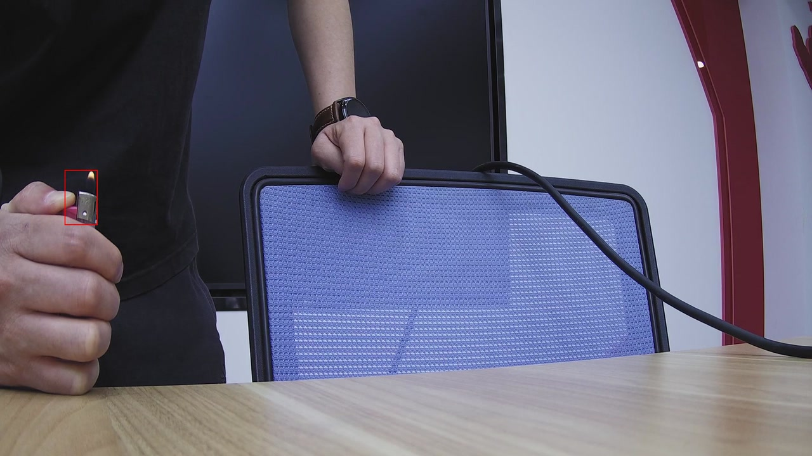
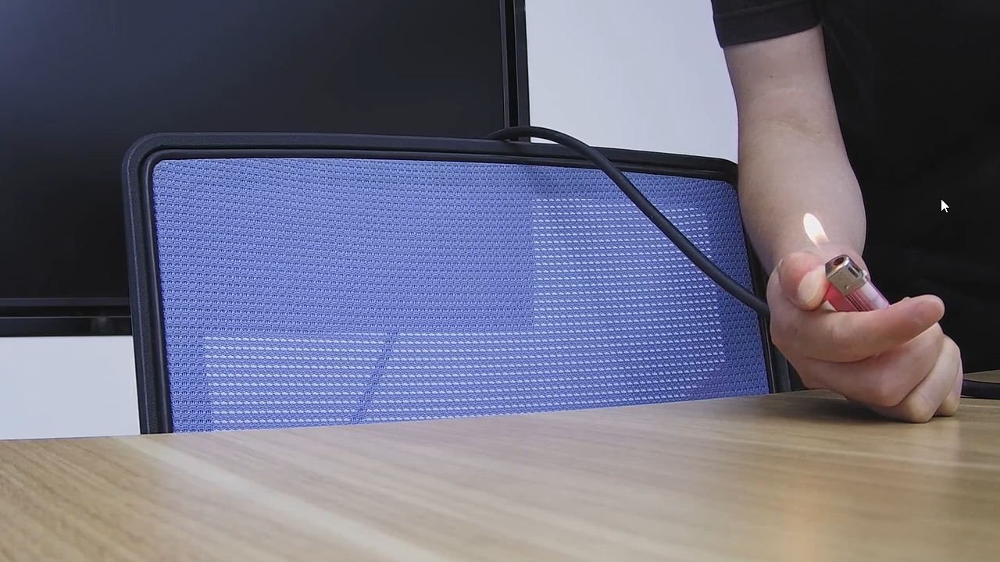

# Vision Hub Platform 视觉智能中枢

> **中文** | [English](README_EN.md)

Vision Hub Platform 是一款开源的视觉算法管理与任务调度平台，面向视频流接入、AI 视觉算法测试、任务编排、截帧分析和事件记录等场景。项目将后端服务、媒体服务、前端控制台和一键 Docker Compose 部署配置放在同一仓库中，方便用户快速搭建完整的视觉智能应用底座。

平台本身不内置大模型推理服务，也不绑定特定算法供应商。你可以在控制台中配置 OpenAI 兼容的视觉大模型接口、接入摄像头或视频流，并将算法与设备绑定成分析任务。

[](docs/images/login-page.png)

## 功能特性

- **算法管理** - 维护视觉算法信息、提示词、输出格式、模型绑定和测试配置。
- **模型配置** - 支持配置 OpenAI 兼容的大模型 API，包括接口地址、API Key、模型标识、上下文长度和最大输出 token。
- **提示词模板** - 内置行业与模板数据，支持按业务场景初始化和复用分析提示词。
- **设备接入** - 支持设备信息维护、视频流地址配置、在线状态检查和流预览。
- **任务编排** - 将任务、算法和设备点位组合起来，按采样间隔定时截帧检测。
- **媒体服务** - 独立媒体服务负责视频流连接、拉流、截帧和快照输出。
- **事件记录** - 算法识别到告警结果后生成事件记录，便于后续查询、处置和导出。
- **一键部署** - Docker Compose 同时启动前端、Web API、媒体服务、MySQL、Redis、Kafka 和 MinIO。

## 开源范围

当前开源版本聚焦视觉算法平台的核心能力：

- 视觉算法管理
- 大模型与提示词配置
- 设备接入与视频流预览
- 任务管理与算法设备绑定
- 截帧检测与算法执行记录
- 告警事件记录

开源版本不包含场景治理、检测区与屏蔽区、组织机构、设备组织树等企业扩展能力。相关示例见下文的 [企业场景治理能力](#企业场景治理能力)，不属于本仓库的开源交付范围。

## 功能界面

以下截图展示开源版覆盖的模型配置、提示词算法、算法测试和事件记录流程。图中的模型与事件使用示例数据，实际界面和识别结果以部署环境为准。

### 模型与算法配置

先接入用户自行提供的视觉模型，再将检测目标和判断标准写成提示词算法。模型服务与 API Key 不随本仓库提供。

[](docs/images/model-management.png)

在模型管理中添加或编辑模型配置，填写模型 ID、推理 URL、API Key 等连接参数。

[](docs/images/model-configuration.png)

模型连接配置完成后，可创建大模型语义算法，绑定已配置的模型，并用提示词定义检测目标和判断标准。

[](docs/images/algorithm-configuration.png)

### 算法测试与调优

上传测试图片后，可查看检测框、告警判断、置信度和文字说明，并据此调整提示词再次测试。截图使用示例数据；运行结果取决于用户配置的视觉模型。

[](docs/images/algorithm-test.png)

### 告警事件记录

算法测试通过后，可以把算法绑定到设备点位并启动定时分析；命中的告警会进入事件记录，供查询和查看。事件详情还会展示告警图片、时间、点位、任务、算法、耗时、置信度和说明。

[](docs/images/event-records.png)

[](docs/images/event-detail.png)

## 技术架构

```text
vision-hub-platform/
├── backend/   # Java / Spring Boot 后端服务
├── frontend/  # Vue 3 前端管理控制台
└── docker/    # Docker Compose 一键部署配置
```

核心组件：

| 模块 | 说明 |
| --- | --- |
| vision-hub-web-server | Web API、任务管理、算法调用、事件记录 |
| vision-hub-media-server | 视频流连接、截帧、快照服务 |
| frontend | Vue 3 管理控制台 |
| MySQL | 业务数据与初始化表结构 |
| Redis | 缓存任务、设备、算法等运行数据 |
| Kafka | 算法结果事件消息 |
| MinIO | 图片、快照和结果图对象存储 |

## 环境要求

推荐使用 Docker Compose 部署，只需要：

- Docker
- Docker Compose

源码运行需要：

- JDK 17+
- Maven 3.8+，也可以使用项目自带 Maven Wrapper
- Node.js 18+
- MySQL 8+
- Redis
- Kafka
- MinIO
- 一个 OpenAI 兼容的视觉大模型 API

## 快速开始

### 方式一：Docker Compose 部署（推荐）

```bash
cd docker
cp .env.example .env
# 首次部署前请修改 .env 中的密码、端口和密钥
docker compose up -d --build
```

启动后访问：

```text
http://localhost
```

默认控制台账号（首次部署后请尽快修改密码）：

```text
用户名：unicom
密码：ZJ_Unicom
```

默认端口：

| 服务 | 端口 | 说明 |
| --- | --- | --- |
| 前端控制台 | 80 | nginx，代理 `/api` 到 Web 服务 |
| Web API | 18080 | Swagger UI: `/swagger-ui/index.html` |
| 媒体服务 | 18081 | 视频流连接与截帧 |
| MySQL | 3306 | 密码来自 `.env` |
| Redis | 6379 | 密码来自 `.env` |
| Kafka | 9092 | 单节点 KRaft 模式 |
| MinIO | 9000 / 9001 | API / Console |

常用命令：

```bash
docker compose ps
docker compose logs -f vision-hub-web-server
docker compose logs -f vision-hub-media-server
docker compose down
docker compose down -v
```

`docker compose down` 会停止服务但保留数据卷；`docker compose down -v` 会删除 MySQL、Redis、Kafka、MinIO 等数据卷，谨慎用于重置环境。

### 方式二：源码运行（开发者）

1. 创建数据库并导入表结构：

   ```bash
   mysql -u root -p -e "CREATE DATABASE vision_hub DEFAULT CHARACTER SET utf8mb4 COLLATE utf8mb4_unicode_ci"
   mysql -u root -p vision_hub < backend/vision-hub-web/vision-hub-web-server/src/main/resources/sql/schema.sql
   ```

2. 配置后端环境变量：

   ```bash
   export DB_URL="jdbc:mysql://localhost:3306/vision_hub?useUnicode=true&characterEncoding=utf8&useSSL=false&serverTimezone=Asia/Shanghai&allowPublicKeyRetrieval=true&nullCatalogMeansCurrent=true"
   export DB_USERNAME="root"
   export DB_PASSWORD="ZJ_Unicom"
   export REDIS_HOST="localhost"
   export REDIS_PORT="6379"
   export REDIS_PASSWORD="ZJ_Unicom"
   export KAFKA_SERVERS="localhost:9092"
   export MINIO_ENDPOINT="http://localhost:9000"
   export MINIO_ACCESS_KEY="ZJ_Unicom"
   export MINIO_SECRET_KEY="ZJ_Unicom"
   export MINIO_BUCKET="vision-hub"
   export INTERNAL_SECRET="ZJ_Unicom"
   export JWT_SECRET="ZJ_Unicom"
   ```

3. 启动后端服务：

   ```bash
   cd backend
   ./mvnw -pl vision-hub-web/vision-hub-web-server -am spring-boot:run
   ./mvnw -pl vision-hub-media/vision-hub-media-server -am spring-boot:run
   ```

4. 启动前端控制台：

   ```bash
   cd frontend
   npm install
   npm run dev
   ```

   本地开发服务默认运行在 `http://localhost:3000`，并将 `/api` 代理到 Web API 服务。

## 模型配置

平台通过 OpenAI 兼容的 `chat/completions` 接口调用视觉大模型。你需要在控制台中配置：

- API 基础地址，例如 `http://your-model-server/v1`；后端会在其后拼接 `chat/completions`，不要重复填写完整路径
- API Key
- 模型标识，例如 `gpt-4o-mini` 或本地模型服务暴露的模型名称
- 模型上下文长度
- 最大输出 token
- 图片传输方式，支持 URL 或 Base64，取决于模型服务能力

模型服务、推理显卡和第三方 API Key 不包含在本项目部署包中，需要用户自行准备。

## 数据与存储

- MySQL、Redis、Kafka、MinIO 使用 Docker 命名卷保存数据。
- 媒体快照默认写入 `docker/data/media-snapshots`。
- 上传文件和算法结果图存储到 MinIO。
- 默认通过前端 nginx 将 `/minio/` 代理到 MinIO，使返回的图片 URL 保持同源。

## 安全说明

- 不要在生产环境使用默认账号、默认数据库密码或默认 JWT 密钥。
- 公网部署建议设置 `SWAGGER_ENABLED=false` 关闭接口文档。
- `docker/.env.example` 仅作为本地体验示例，部署时请复制为 `.env` 并修改所有敏感配置。

## 常见问题

**项目会一起部署所有中间件吗？**

会。Docker Compose 版本会启动 MySQL、Redis、Kafka、MinIO、前端、Web API 和媒体服务，适合本地体验、测试和中小规模私有化部署。生产环境也可以改造为使用外部中间件。

**项目是否内置视觉大模型？**

不内置。平台负责模型配置、任务编排、图片截帧和结果记录，具体推理能力由用户配置的 OpenAI 兼容模型服务提供。


**已有数据库升级时是否只执行 `schema.sql`？**

不是。`schema.sql` 主要用于全新初始化数据库。已经部署过的环境建议使用 migration 脚本升级表结构或补充初始化数据，避免覆盖旧数据。

## 企业落地技术支撑

Vision Hub Platform 虽然开源，但真实企业落地通常不仅是把服务启动起来，还涉及业务场景治理、流程设计、算法策略配置和现有系统集成。这类工作需要结合现场业务、网络环境、设备协议、数据安全和运维要求进行专业设计。

### 企业场景治理能力

**场景治理、检测区与屏蔽区、组织机构等企业扩展能力不包含在本开源仓库，也不会通过本仓库的 Docker Compose 部署获得。**

以下图片展示企业场景中可扩展的配置和验证方式。

企业扩展的任务配置界面提供场景治理入口，可在任务与设备点位的基础上继续设置区域规则。

[](docs/images/enterprise-task-configuration.png)

场景治理支持在设备画面上绘制复杂多边形检测区和屏蔽区，并按实际场景组合多条规则、设置多个区域。检测区限定重点关注范围，屏蔽区排除固定干扰；区域规则可结合模型输出的目标坐标，决定是否形成最终告警，从而灵活适配不同画面结构和业务需求。

[](docs/images/enterprise-region-configuration.png)

下面是同一摄像头、同一算法的左右点火对照输入画面。根据示例中的区域规则，左侧非屏蔽区域的火焰形成告警，右侧屏蔽区域的火焰不形成最终告警。两张画面用于说明对照条件，具体结果仍需结合事件记录核对。

| 左侧：非屏蔽区域，形成告警 | 右侧：屏蔽区域，不形成最终告警 |
| :---: | :---: |
| [](docs/images/enterprise-fire-unmasked.jpg) | [](docs/images/enterprise-fire-masked.png) |

如需企业落地咨询与技术支持，欢迎联系我们：

- **电话 / 微信**：**15657170299**（微信同号）

我们可协助完成从需求调研、场景治理、流程方案设计、系统集成到部署运维的端到端落地，让视觉智能能力真正跑进业务流程。

## 许可证

[MIT](LICENSE) © ZJ-Unicom-AI
