# Vision Hub Platform

> [中文](README.md) | **English**

Vision Hub Platform is an open-source platform for visual algorithm management, video stream access, task orchestration, frame capture, AI-powered image analysis, and event records. The repository includes the backend services, media service, frontend console, and an all-in-one Docker Compose deployment so users can quickly start a complete visual intelligence platform.

The platform does not bundle an inference engine or depend on a specific model provider. You can configure an OpenAI-compatible vision model API, register cameras or video streams, bind algorithms to devices, and run scheduled analysis tasks from the console.

[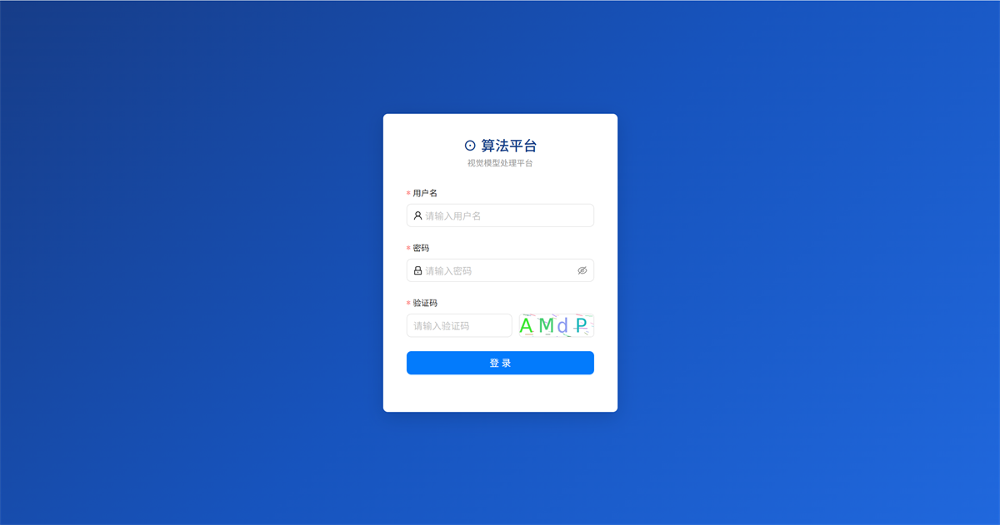](docs/images/login-page.png)

## Features

- **Algorithm Management** - Manage visual algorithms, prompts, output formats, model bindings, and test settings.
- **Model Configuration** - Configure OpenAI-compatible model APIs, including endpoint, API key, model id, context length, and maximum output tokens.
- **Prompt Templates** - Seed and reuse industry-specific prompt templates for common visual inspection scenarios.
- **Device Access** - Manage device metadata, stream URLs, status checks, and video previews.
- **Task Orchestration** - Bind tasks, algorithms, and device points, then run scheduled frame analysis by sampling interval.
- **Media Service** - A standalone media service handles stream connections, frame capture, and snapshots.
- **Event Records** - Alarm results from algorithm execution are converted into searchable event records.
- **One-Command Deployment** - Docker Compose starts the frontend, Web API, media service, MySQL, Redis, Kafka, and MinIO.

## Open-Source Scope

This edition focuses on the core capabilities of a visual algorithm platform:

- visual algorithm management
- model and prompt configuration
- device access and stream preview
- task management with algorithm-device binding
- frame capture and algorithm execution logs
- alarm event records

Scene governance, detection and exclusion regions, organization management, and device organization trees are enterprise extensions and are not included in this open-source repository. See [Enterprise Scene Governance](#enterprise-scene-governance) for examples of these capabilities.

## Interface Preview

The following screenshots illustrate model configuration, prompt-based algorithms, algorithm testing, and event records covered by the open-source edition. The models and events shown are example data; actual screens and results depend on your deployment.

### Model and Algorithm Configuration

Connect a vision model you provide, then express the detection target and criteria in a prompt-based algorithm. Model services and API keys are not bundled with this repository.

[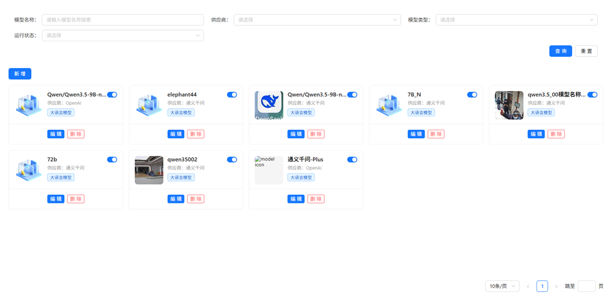](docs/images/model-management.png)

Add or edit a model configuration with its model ID, inference URL, API key, and other connection settings.

[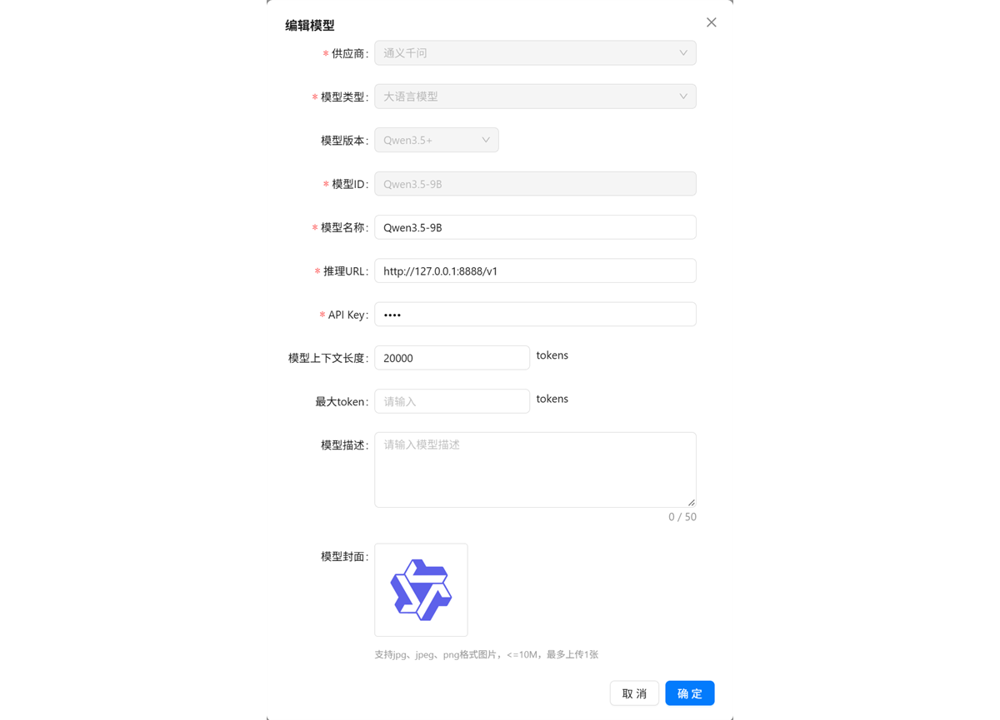](docs/images/model-configuration.png)

After connecting a model, create a vision algorithm, bind it to the configured model, and define its detection target and criteria with a prompt.

[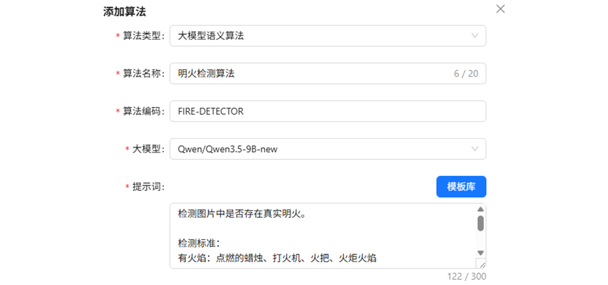](docs/images/algorithm-configuration.png)

### Algorithm Testing and Tuning

Upload a test image to inspect the detection box, alarm result, confidence, and description, then refine the prompt and test again. The screenshot uses example data; actual results depend on the vision model you configure.

[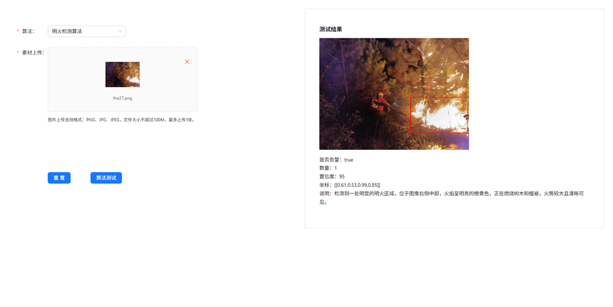](docs/images/algorithm-test.png)

### Alarm Event Records

After validating an algorithm, bind it to device points and start scheduled analysis. Alarm hits become searchable event records. Event details show the alarm image, time, device point, task, algorithm, execution time, confidence, and description.

[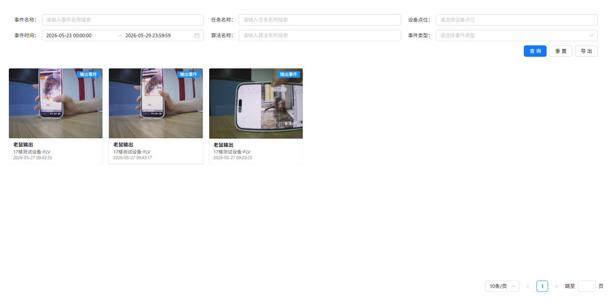](docs/images/event-records.png)

[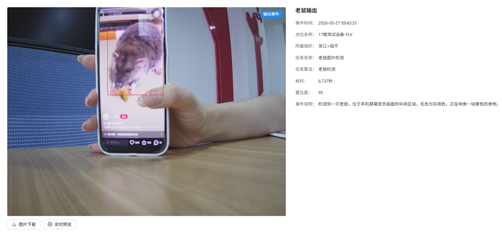](docs/images/event-detail.png)

## Architecture

```text
vision-hub-platform/
├── backend/   # Java / Spring Boot backend services
├── frontend/  # Vue 3 management console
└── docker/    # Docker Compose deployment
```

Core components:

| Component | Description |
| --- | --- |
| vision-hub-web-server | Web API, task management, algorithm invocation, and event records |
| vision-hub-media-server | Video stream connection, frame capture, and snapshots |
| frontend | Vue 3 management console |
| MySQL | Business data and initial schema |
| Redis | Runtime cache for tasks, devices, and algorithms |
| Kafka | Algorithm result messages |
| MinIO | Object storage for snapshots, uploads, and result images |

## Requirements

Docker Compose deployment only requires:

- Docker
- Docker Compose

Running from source requires:

- JDK 17+
- Maven 3.8+ or the included Maven Wrapper
- Node.js 18+
- MySQL 8+
- Redis
- Kafka
- MinIO
- An OpenAI-compatible vision model API

## Quick Start

### Option 1: Docker Compose (Recommended)

```bash
cd docker
cp .env.example .env
# Edit .env to change passwords, ports, and secrets before deployment.
docker compose up -d --build
```

Open:

```text
http://localhost
```

Default console account (change the password as soon as possible after first deployment):

```text
Username: unicom
Password: ZJ_Unicom
```

Default ports:

| Service | Port | Description |
| --- | --- | --- |
| Frontend console | 80 | nginx, proxies `/api` to the Web service |
| Web API | 18080 | Swagger UI: `/swagger-ui/index.html` |
| Media service | 18081 | Stream connection and frame capture |
| MySQL | 3306 | Password from `.env` |
| Redis | 6379 | Password from `.env` |
| Kafka | 9092 | Single-node KRaft mode |
| MinIO | 9000 / 9001 | API / Console |

Useful commands:

```bash
docker compose ps
docker compose logs -f vision-hub-web-server
docker compose logs -f vision-hub-media-server
docker compose down
docker compose down -v
```

`docker compose down` stops services while keeping data volumes. `docker compose down -v` removes MySQL, Redis, Kafka, and MinIO data volumes, so use it carefully when resetting an environment.

### Option 2: Build from Source

1. Create the database and import the schema:

   ```bash
   mysql -u root -p -e "CREATE DATABASE vision_hub DEFAULT CHARACTER SET utf8mb4 COLLATE utf8mb4_unicode_ci"
   mysql -u root -p vision_hub < backend/vision-hub-web/vision-hub-web-server/src/main/resources/sql/schema.sql
   ```

2. Configure backend environment variables:

   ```bash
   export DB_URL="jdbc:mysql://localhost:3306/vision_hub?useUnicode=true&characterEncoding=utf8&useSSL=false&serverTimezone=Asia/Shanghai&allowPublicKeyRetrieval=true&nullCatalogMeansCurrent=true"
   export DB_USERNAME="root"
   export DB_PASSWORD="ZJ_Unicom"
   export REDIS_HOST="localhost"
   export REDIS_PORT="6379"
   export REDIS_PASSWORD="ZJ_Unicom"
   export KAFKA_SERVERS="localhost:9092"
   export MINIO_ENDPOINT="http://localhost:9000"
   export MINIO_ACCESS_KEY="ZJ_Unicom"
   export MINIO_SECRET_KEY="ZJ_Unicom"
   export MINIO_BUCKET="vision-hub"
   export INTERNAL_SECRET="ZJ_Unicom"
   export JWT_SECRET="ZJ_Unicom"
   ```

3. Start backend services:

   ```bash
   cd backend
   ./mvnw -pl vision-hub-web/vision-hub-web-server -am spring-boot:run
   ./mvnw -pl vision-hub-media/vision-hub-media-server -am spring-boot:run
   ```

4. Start the frontend console:

   ```bash
   cd frontend
   npm install
   npm run dev
   ```

   The local frontend dev server runs at `http://localhost:3000` and proxies `/api` to the Web API service.

## Model Configuration

The platform calls vision models through OpenAI-compatible `chat/completions` APIs. Configure the following fields in the console:

- API base URL, for example `http://your-model-server/v1`; the backend appends `chat/completions`, so do not enter the full path twice
- API key
- Model id, such as `gpt-4o-mini` or a model name exposed by your local model server
- Model context length
- Maximum output tokens
- Image transfer mode, URL or Base64 depending on model server capability

Model services, inference GPUs, and third-party API keys are not included in this project. Users need to provide them separately.

## Data and Storage

- MySQL, Redis, Kafka, and MinIO use Docker named volumes.
- Media snapshots are written to `docker/data/media-snapshots` by default.
- Uploaded files and algorithm result images are stored in MinIO.
- The bundled frontend nginx proxies `/minio/` to MinIO so returned image URLs remain same-origin.

## Security

- Do not use default accounts, database passwords, or JWT secrets in production.
- For public deployments, set `SWAGGER_ENABLED=false` to disable API documentation.
- `docker/.env.example` is only a local evaluation template. Copy it to `.env` and change all sensitive values before deployment.

## FAQ

**Does Docker Compose deploy all middleware services?**

Yes. The Compose stack starts MySQL, Redis, Kafka, MinIO, the frontend, the Web API, and the media service. It is suitable for local evaluation, testing, and small to medium private deployments. Production environments can be adapted to use external middleware.

**Does this project include a vision model?**

No. The platform handles model configuration, task orchestration, frame capture, and result records. Actual inference is provided by the OpenAI-compatible model service configured by the user.


**Should existing databases be upgraded with `schema.sql` only?**

No. `schema.sql` is mainly for fresh database initialization. Existing deployments should use migration scripts to upgrade table structures or seed new data without overwriting existing data.

## Enterprise Adoption Support

Although Vision Hub Platform is open source, real enterprise adoption usually involves more than starting the services. Production projects often require scenario governance, workflow design, algorithm strategy configuration, and integration with existing business systems. This type of work requires professional design based on the on-site business context, network environment, device protocols, data security requirements, and operations requirements.

### Enterprise Scene Governance

**Scene governance, detection and exclusion regions, and organization management are enterprise extensions that are not included in this open-source repository or its Docker Compose deployment.** The following images illustrate configuration and validation options for enterprise scenarios.

The enterprise task configuration screen provides an entry to scene governance, where region rules can be added to tasks and device points.

[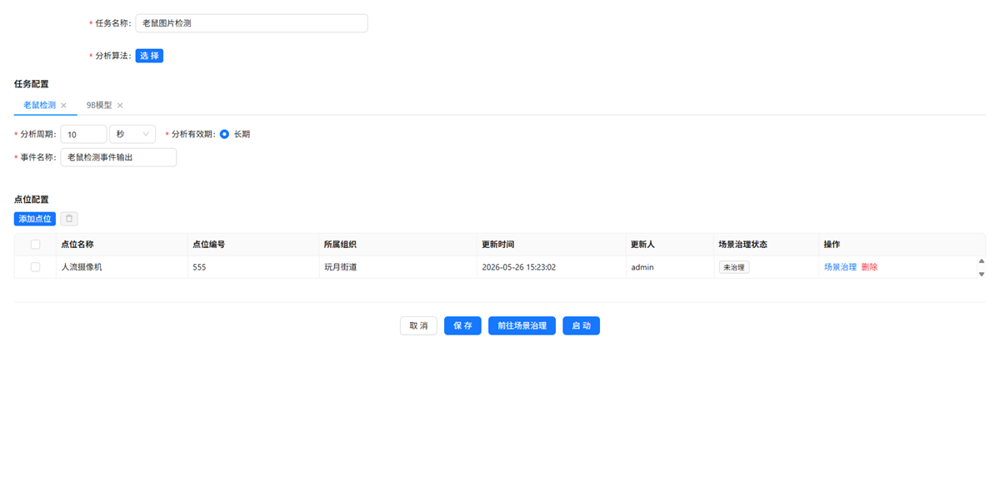](docs/images/enterprise-task-configuration.png)

Scene governance supports drawing complex polygonal detection and exclusion regions on a device image, combining multiple rules, and configuring multiple regions to suit each scenario. Detection regions define areas of interest, while exclusion regions remove fixed sources of interference. Region rules can use model output coordinates to decide whether a detection becomes a final alarm, allowing the configuration to adapt to different camera views and operational requirements.

[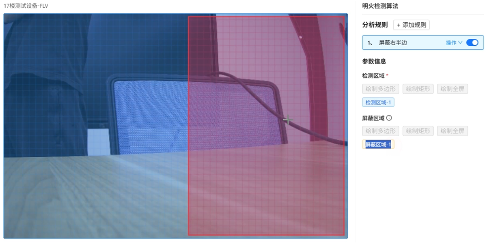](docs/images/enterprise-region-configuration.png)

The following frames show a left-versus-right fire test using the same camera and algorithm. Under the example's region rules, fire in the unmasked left area produces an alarm, while fire in the excluded right area does not produce a final alarm. These frames illustrate the test conditions; check the event records to verify the outcome.

| Left: outside the exclusion region, alarm produced | Right: inside the exclusion region, no final alarm |
| :---: | :---: |
| 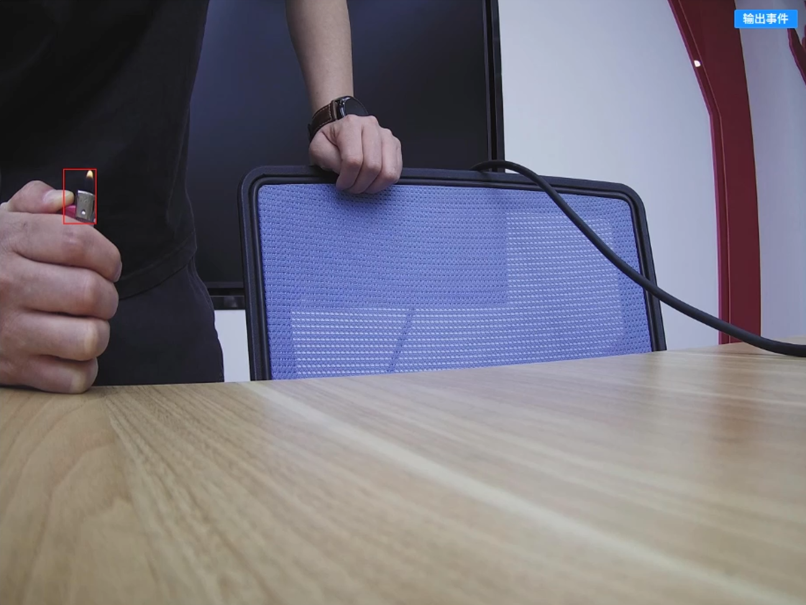 | 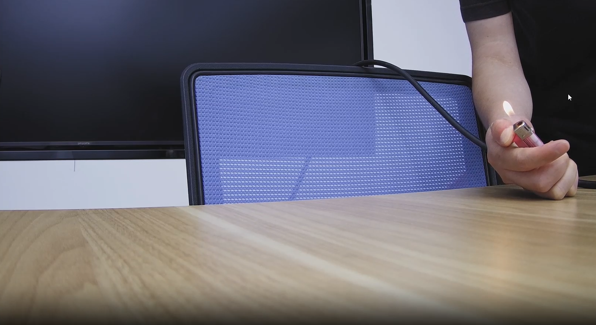 |

For enterprise consulting and technical support, please contact us:

- **Phone / WeChat**: **15657170299** (same number for WeChat)

We can help with end-to-end delivery, including requirement research, scenario governance, workflow solution design, system integration, deployment, and operations support, so visual intelligence capabilities can truly run inside real business workflows.

## License

[MIT](LICENSE) © ZJ-Unicom-AI
